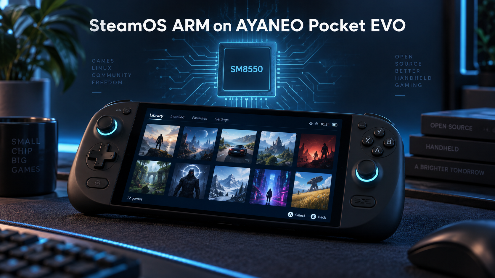

# evo-sm8550-fixes

**English version: [README.md](README.md)**

[MaSieS4Fun의 SteamOS ARM (SM8550)](https://github.com/MaSieS4Fun/SteamOS-ARM-SM8550) 테스트 이미지를 **AYANEO Pocket EVO**에서 구동하기 위한 임시 수정 모음입니다.
여기 있는 모든 내용은 실기기(EVO Retro Power 에디션)에서 검증했습니다.

## 상태 (2026-10-15)

`steamos-AYANEO-TEST-2`에서 콜드 리부팅 후 검증 완료: 디스플레이, 터치, 내장 패드(모든 버튼, 스틱,
아날로그 트리거, 십자키), 추가 버튼 4개(Steam / QAM / L4 / R4 / R5, InputPlumber 경유), Wi-Fi, 데스크톱
화면 방향. Renesas 모듈과 InputPlumber 프로필은 부팅 시 자동으로 로드됩니다.

`SteamOS-ARM-SM8550 v1.1.1`(커널 `7.2.9-edge-sm8550`)은 EVO DTB에 이미 `splash_region@b8000000`을 유지하고
있지만(수정 내용과 동일), Renesas 모듈, 추가 버튼 DTB 노드, InputPlumber 프로필, 데스크톱 화면 방향
수정은 아직 없습니다. 워크플로는 7.2.8과 7.2.9 둘 다용으로 모듈을 빌드하고, `patch_kernel_evo.py`는
기존 splash 노드가 동일하면 유지한 채 버튼 노드만 추가합니다.

## 발견한 문제들

| 증상 | 원인 | 해결 | 위치 |
|---|---|---|---|
| Snapdragon 로고 후 화면이 까맣게 유지됨 | `dtb-chain/sanitize.sh`가 EVO DTB에서 `reserved-memory/splash_region@b8000000`을 제거함 | 노드 유지 (`reg = <0x0 0xb8000000 0x0 0x2b00000>`, `no-map`) | `dts/pocket-evo-fixes.dtsi` |
| 내장 패드가 아예 동작 안 함 | 패드가 Renesas uPD720201 PCIe xHCI (1912:0014) 뒤에 붙어 있음; 커널에 `# CONFIG_USB_XHCI_PCI_RENESAS is not set` | `xhci-pci-renesas.ko` (이 레포에서 빌드) / `CONFIG_USB_XHCI_PCI_RENESAS=m` | `.github/workflows/build-xhci-renesas.yml` |
| 추가 버튼 4개가 동작 안 함 | TLMM GPIO 키라서 패드에 연결돼 있지 않음; EVO DTB의 gpio-keys에는 볼륨 업만 있음 | `gpio-keys-pocket-evo` 노드 + 풀업 pinctrl, 값은 순정 Android DT에서 가져옴 | `dts/pocket-evo-fixes.dtsi` |
| 추가 버튼을 Steam에서 쓸 수 없음 | EVO용 InputPlumber 프로필이 없음 | 복합 디바이스 -> 가상 Steam Deck (deck-uhid) | `inputplumber/` |
| 데스크톱 모드 화면이 거꾸로 | `sm8550-display.conf`에 EVO가 `right\|Rotated270`으로 등록됨 | `left\|Rotated90` (DTS rotation = 270, Odin 2 Portal과 동일) | `image-config/sm8550-display.conf.patch` |

## 버튼 배치 (InputPlumber -> Steam Deck)

| EVO | Steam Deck |
|---|---|
| A / B / X / Y, L1 / R1, L2 / R2 (아날로그), L3 / R3, Select / Start, 스틱, 십자키 | 동일 위치 |
| Home | Steam (Guide) |
| 오른쪽 AYANEO 버튼 | Quick Access |
| 오른쪽 아래 버튼 | R5 |
| 왼쪽 안쪽 트리거 버튼 | L4 |
| 오른쪽 안쪽 트리거 버튼 | R4 |

## 설치 (공식 빌드에 포함되기 전까지의 임시 방법)

```sh
# 모듈 (워크플로 아티팩트)
sudo install -D -m644 xhci-pci-renesas.ko /lib/modules/$(uname -r)/updates/xhci-pci-renesas.ko
sudo depmod -a $(uname -r)

# InputPlumber 프로필
sudo install -m644 inputplumber/devices.d/03-ayaneo-pocket-evo.yaml /etc/inputplumber/devices.d/
sudo install -m644 inputplumber/capability_maps.d/ayaneo_evo.yaml /etc/inputplumber/capability_maps.d/
sudo systemctl restart inputplumber
```

### DTB (splash 영역 + 추가 버튼)

DTB 변경은 FAT 부트 파티션에 있는 이미지의 `KERNEL` 파일 안 EVO DTB에 적용합니다
(Android 부트 이미지 v0, gzip 커널 + DTB 덧붙이기 형식). `tools/patch_kernel_evo.py`가 커널 트리 없이 이 작업을 해줍니다:

```sh
pip install fdt
cp KERNEL KERNEL.orig                       # 원본 보관
python3 tools/patch_kernel_evo.py KERNEL.orig KERNEL
```

모델이 `AYANEO Pocket EVO`인 DTB 하나를 찾아 `dts/pocket-evo-fixes.dtsi`와 같은 노드를 추가하고
(기존 splash 노드는 검증된 것과 일치할 때만 유지),
나머지는 바이트 단위로 그대로 복사한 뒤 헤더 크기/SHA1을 다시 씁니다. 이미 패치된 DTB는 거부합니다.
TEST-2에서 출력물은 실기기에서 검증한 KERNEL과 바이트 단위로 동일했습니다.

### 데스크톱 화면 방향

`image-config/sm8550-display.conf.patch`를 `/usr/share/steamos-odin/devices/sm8550-display.conf`에 적용합니다
(한 줄짜리이며 게임 모드에는 영향 없음). 원본 파일은 백업해 두세요.

### 롤백

모듈과 InputPlumber 파일을 지우고, `depmod -a`, InputPlumber 재시작,
`KERNEL.orig`와 원본 `sm8550-display.conf`를 되돌리면 됩니다.

## 레포 구성

| 경로 | 내용 |
|------|----------|
| `.github/workflows/build-xhci-renesas.yml` | 이미지 커널용 `xhci-pci-renesas.ko` 빌드 |
| `dts/pocket-evo-fixes.dtsi` | DTB 수정: splash 영역 + 추가 버튼 GPIO 키 |
| `inputplumber/` | EVO 디바이스 프로필과 capability map (가상 Steam Deck) |
| `image-config/sm8550-display.conf.patch` | 데스크톱 화면 방향 수정 (한 줄) |
| `tools/patch_kernel_evo.py` | 이미지의 `KERNEL` 파일 안 EVO DTB 패치 |
| `config/` | 이미지 커널의 커널 설정 (7.2.8 / 7.2.9) |

## 워크플로가 빌드하는 것

`.github/workflows/build-xhci-renesas.yml`은 이미지 커널 `7.2.8-edge-sm8550`(TEST-2)과
`7.2.9-edge-sm8550`(v1.1.1)용으로 `xhci-pci-renesas.ko`만 빌드합니다
(vanilla kernel.org 소스 + 이미지에 들어있던 IKCONFIG, `USB_XHCI_PCI_RENESAS=m`,
이미지와 동일한 gcc 15.2.0-16ubuntu1). vermagic이 정확히
`<kver>-edge-sm8550 SMP preempt mod_unload aarch64`가 아니면 잡이 실패합니다.
펌웨어 `renesas_usb_fw.mem`은 이미지에 이미 포함돼 있습니다.
